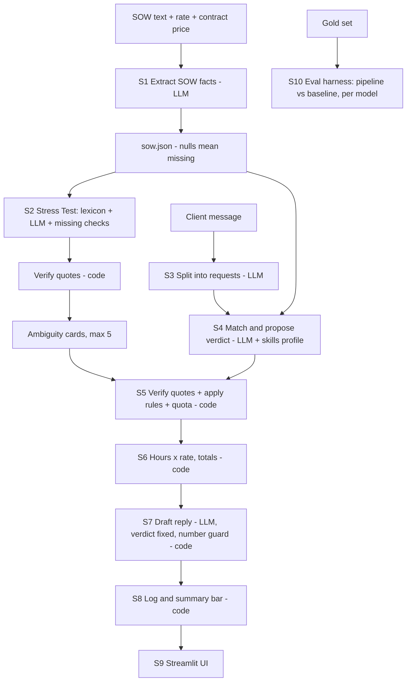

# Scope-Creep Catcher: Final Implementation Plan

**What this file is:** the single build plan for our Hacktoberfest Open-Source AI Challenge, Week 2 (Side Hustle) entry. It says what we build, in what order, how we check it works, and how each step meets the challenge requirements. The long explanation of *why* the design works is in `THEORY.md`.

**One-line pitch:** a local, open-weight tool that helps freelancers stop doing unpaid extra work. It stress-tests the Statement of Work (SOW) before the project, checks every client request against it during the project, proves every claim with a verified quote, and drafts the polite priced reply.

> **Status:** planning, today is Thu Oct 15, 2026. Deadline: **Sun Oct 18, 11:59 PM PDT = Mon Oct 19, about 12:29 PM IST.** Treat Sunday night IST as the real deadline. Monday morning is for emergencies only.
>
> **Honest goal:** a working, honest, well-written submission with real measured numbers and one real first user. Winning is not in our control. Partner categories are a bonus, not the plan.
>
> **File move on Day 4:** this file moves to `docs/IMPLEMENTATION_PLAN.md`, and a short public `README.md` (skeleton in section 18) replaces it.

---

## Table of contents

1. [Challenge requirements checklist](#1-challenge-requirements-checklist)
2. [Product definition](#2-product-definition)
3. [Scope: must, should, could](#3-scope-must-should-could)
4. [Architecture and step-by-step requirement mapping](#4-architecture-and-step-by-step-requirement-mapping)
5. [Tech stack, setup, hardware and speed budget](#5-tech-stack-setup-hardware-and-speed-budget)
6. [Repository structure](#6-repository-structure)
7. [Data model and schemas](#7-data-model-and-schemas)
8. [Module specs](#8-module-specs)
9. [UI spec](#9-ui-spec)
10. [Evaluation plan](#10-evaluation-plan)
11. [Partner technologies: plan, costs, alternatives](#11-partner-technologies-plan-costs-alternatives)
12. [Schedule with checkpoints and cut rules](#12-schedule-with-checkpoints-and-cut-rules)
13. [First-user plan](#13-first-user-plan)
14. [Demo video storyboard](#14-demo-video-storyboard)
15. [DEV post plan](#15-dev-post-plan)
16. [Submission checklist and rule compliance](#16-submission-checklist-and-rule-compliance)
17. [Risks and mitigations](#17-risks-and-mitigations)
18. [Public README skeleton](#18-public-readme-skeleton)
19. [Licenses, credits, disclaimer](#19-licenses-credits-disclaimer)

---

## 1. Challenge requirements checklist

Everything below was read from the official Week 2 challenge page and the HF26 hub. Re-check the pages once before submitting because details can change.

| # | Requirement | How we meet it | Evidence we will show |
|---|---|---|---|
| R1 | Open-source AI at the core: open-weight model, open-source framework, or local inference. The open pieces must be what makes the project work. | Ollama runs open-weight models locally for every language step. Nothing works without them. | Repo, `requirements.txt`, model names and licenses in the README |
| R2 | Something someone would actually pay for | Freelancers lose paid hours to scope creep. Output is a priced change order. | Estimated extra hours flagged, first-user answer on paying |
| R3 | Small, specific, useful for a real person | One user (solo freelancer), one problem (unpaid extras), paste-and-go | First-user session |
| R4 | Post explains **why open innovation matters** (offline, data stays local, swap or fine-tune models, costs nothing to run, better than closed where?) | Demo with Wi-Fi off, no cloud calls, model swap Qwen vs Gemma, zero per-token cost | Video segment, `metrics.json`, model comparison table |
| R5 | Bonus: land a first user, report honestly | Session with one real freelancer, including negative answers | "My First User" section |
| R6 | New project; repo started and finished inside Oct 12 to 18; post-deadline commits noted in README | Create repo on or after Oct 12, never reuse old code beyond credited libraries | First commit date, README note |
| R7 | Submission post on DEV using the template, tags `devchallenge` and `hf26challenge` | Post written from the template (section 15) | Published post |
| R8 | Demo (deployed link or video) and code link | Screen-recorded video (local app cannot be tried by judges) plus GitHub repo | Video embed, repo embed |
| R9 | Judging: Writing Quality (most weight), Relevance, Creativity, Technical Execution, optional Partner Tech | Section 15 for writing, sections 4 and 10 for execution | Post and eval table |
| R10 | One submission per challenge, 18+, English for prize eligibility, teams up to 4 with DEV handles listed, credit prior work | Section 16 | Post body |

---

## 2. Product definition

**User:** a solo freelancer or tiny studio on fixed-price projects (web, writing, video). Best fit: newer freelancers, and anyone handed a client-written contract.

**Problem:** vague SOW wording ("minor revisions", "a few pages") and awkward pushback mean freelancers give away hours.

**What it does (three parts):**
1. **SOW Stress Test:** finds vague or missing wording and gives copy-paste rewrites.
2. **Request Checker:** splits a client message into requests, classifies each as in scope / out of scope / gray area, and backs it with verified quotes from the SOW and the client message.
3. **Reply and Change Order Drafter:** writes a polite reply, a clarifying question for gray areas, and a priced Markdown change-order block. A running log tracks estimated extra work.

**Differentiator (stated honestly):** the basic request checker is already sold by others (ScopeGuard Pro, ScopeAuditor, ScopeCtrl and more, per our earlier shallow searches, which we have **not** verified). Our angle is the combination: stress-test the SOW first, link those weak clauses to the live checker, verify every quote with code, and run fully on a local open-weight model.

**Non-goals:** legal advice, Gmail/Slack integration, branded PDFs, user accounts, cloud storage.

**Money story (hypothesis, to be tested with the first user):** one prevented unpaid revision round is worth more than a small one-time price. We do not claim a price. We ask the first user and report the answer.

---

## 3. Scope: must, should, could

| Priority | Feature | Why |
|---|---|---|
| **P0 (must ship)** | SOW extraction to JSON; Request Checker with verified quotes and rules; pricing math; drafter with number guard; JSON log; basic Streamlit UI; eval on gold set; DEV post with video | This is the product and the evidence |
| **P1 (should)** | SOW Stress Test (lexicon + LLM + missing-item checks) linked to the checker; quota counter with user confirmation; 2 skills files; Qwen vs Gemma comparison; single-prompt baseline ablation | Creativity and technical depth |
| **P2 (could)** | Side-by-side SOW highlighting; tone switcher (3 tones); Backboard model comparison; landing page on `.tech`; Sentry tracing; `.txt` upload | Polish and partner bonuses |
| **Cut** | PDF input, Gmail/Slack, pushback simulator, Tender Matcher and other appendix ideas, LLM-guessed worst-case dollar costs, `graphic_design.md` (no gold cases) | Not worth the time or untested |

**Cut rule:** if a checkpoint in section 12 is missed, drop from the bottom of the P2 list upward. Never cut the verifier or the eval.

---

## 4. Architecture and step-by-step requirement mapping

Design principle: **the LLM reads, explains and writes. Code finds, verifies, decides and calculates.** The model never does arithmetic and never has the last word on a verdict.



| Step | What happens | LLM or code | Challenge requirement it serves | Evidence |
|---|---|---|---|---|
| **S0 Input** | Paste SOW text, enter hourly rate, currency, contract price | Code | R3 small and specific | Demo |
| **S1 Extract SOW** | Turn SOW into `sow.json`. Missing field stays `null` (missing is not "unlimited") | LLM, JSON-schema constrained | R1 open model is the core | Schemas, README |
| **S2 Stress Test** | Lexicon finds candidate vague phrases, LLM judges and explains them, code adds "missing" cards from `null` fields, code verifies quotes, top 5 by severity | LLM + code | Creativity (pre-signing check) | Stress precision and recall metrics |
| **S3 Split request** | Break a client message into atomic requests with type and magnitude | LLM | R1 | Demo |
| **S4 Match and propose** | For each request find the clause, propose verdict, quote both sides, using the niche skills profile | LLM | R1, R4 (behaviour changeable via open `skills/*.md`) | Skills files |
| **S5 Verify and decide** | Normalized exact quote check, fuzzy fallback with exact numbers, rules for pages, revisions, exclusions, quota, gray area, confidence | Code | Technical Execution, trust | Unit tests, quote-failure metric |
| **S6 Pricing** | `hours x rate`, totals, `% over scope` from `price / rate` | Code | R2 someone would pay | Summary bar |
| **S7 Draft** | Reply, clarifying question, change-order block. Verdict and numbers are fixed inputs, a guard checks the draft | LLM + code | R2, R3 | Demo |
| **S8 Log** | Local JSON log with status pending/approved/declined and totals | Code | R4 data stays local | Wi-Fi-off demo |
| **S9 UI** | Streamlit with 3 tabs and a top summary bar | Code | R8 demo | Video |
| **S10 Eval** | Gold set, metrics per model, baseline vs pipeline, latency and tokens | Code | Technical Execution, R4 (swap models, cost) | `results/` |

---

## 5. Tech stack, setup, hardware and speed budget

| Layer | Choice | Notes |
|---|---|---|
| Runtime | **Ollama** (local) | Fallback: `llama.cpp` `llama-server` (open source, check its docs for JSON-schema output) |
| Primary model | `qwen2.5:7b` | As far as we know the 7B is Apache-2.0, but 3B uses a different license. Check each model page and write the license in the README |
| Comparison model | **a Gemma tag from the Ollama library** (pick a size that fits your RAM) | Needed for the Gemma category. Gemma has its own terms of use |
| Weak-hardware model | `qwen2.5:3b` or a ~4B Gemma | Only if 7B is too slow |
| Output control | Ollama `format=<JSON schema from Pydantic>` | Guarantees valid JSON shape, not correct content |
| Validation | Pydantic v2 | Retry once on validation failure |
| Fuzzy match | `rapidfuzz` | Check `partial_ratio_alignment` in its docs |
| UI | Streamlit | Three tabs and a summary bar |
| Config | PyYAML for `hours.yaml` and `lexicon.yaml` | Editable rule tables |
| Storage | JSON files in `data/projects/` (git-ignored) | No accounts, no cloud |
| Tests | pytest | Verifier, rules, pricing, draft guard |
| Optional | `sentry-sdk`, `pymupdf` | Sentry off by default. PDF only if time is left |

**Setup (Day 0, about 1 hour):**
```bash
# 1. Install Ollama from ollama.com, then:
ollama pull qwen2.5:7b
ollama pull <gemma-tag-that-fits-your-RAM>

# 2. Speed test: note the "eval rate" (tokens/s)
ollama run qwen2.5:7b --verbose "Write two sentences about invoices."

# 3. Project
mkdir scope-creep-catcher && cd scope-creep-catcher
git init && python -m venv .venv && source .venv/bin/activate
pip install streamlit ollama pydantic rapidfuzz pyyaml pytest
pip freeze > requirements.txt
```

**Speed budget (decide the model tier today):**

| Measured eval rate | Plan |
|---|---|
| above ~15 tokens/s | 7B to 9B model is fine |
| ~5 to 15 tokens/s | Use a 3B to 4B model for the checker. Keep outputs short |
| below ~5 tokens/s | Shrink schemas, cap `num_predict`, use 1.5B to 3B, and say plainly in the post that the demo was recorded on slow hardware. Never fake speed |

A client message costs about `1 (split) + n (match) + 1 (draft)` model calls. With 3 requests that is 5 calls. At 10 tokens/s and ~120 output tokens per call, expect about a minute. SOW extraction runs once and is cached.

**Context:** Ollama's default context is small, so set `num_ctx` to 8192 for SOWs. Long contracts: split into ~1,500-token paragraph windows, run per window, merge, dedupe by quote.

---

## 6. Repository structure

```
scope-creep-catcher/
├── README.md                  # public README (written Day 4)
├── docs/
│   ├── IMPLEMENTATION_PLAN.md # this file
│   └── THEORY.md
├── app.py                     # Streamlit UI
├── engine/
│   ├── config.py              # model names, seed, num_ctx, paths
│   ├── llm.py                 # Ollama wrapper, JSON schema, retry, metrics
│   ├── schemas.py             # Pydantic models
│   ├── sow.py                 # S1 extraction
│   ├── lexicon.py             # vague-phrase scanner
│   ├── stress_test.py         # S2
│   ├── checker.py             # S3 + S4
│   ├── verifier.py            # quote verification
│   ├── rules.py               # S5 decision rules
│   ├── pricing.py             # S6
│   ├── drafter.py             # S7 + number guard + change-order template
│   ├── state.py               # S8 project JSON, quota, log
│   └── tracing.py             # optional Sentry, metadata only
├── prompts/                   # *.txt prompt templates
├── skills/                    # web_dev.md, copywriting.md
├── config/
│   ├── hours.yaml
│   └── lexicon.yaml
├── data/
│   ├── gold/                  # sows/*.txt, cases.json
│   └── projects/              # git-ignored, real user data lives here
├── eval/
│   ├── run_eval.py            # pipeline and baseline modes, per model
│   ├── metrics.py
│   ├── baseline.py            # single-prompt baseline
│   ├── make_report.py         # results/RESULTS.md
│   └── run_backboard.py       # optional, synthetic data only
├── tests/
├── results/
├── site/                      # optional landing page
├── .gitignore                 # data/projects/, .venv/, results/raw/
├── LICENSE                    # MIT for our code. Model licenses are separate
└── requirements.txt
```

---

## 7. Data model and schemas

All model calls use these Pydantic models. `model_json_schema()` goes into Ollama's `format` option, and the response is validated again with `model_validate_json`.

```python
# engine/schemas.py
from typing import Literal, Optional
from pydantic import BaseModel, Field

Verdict  = Literal["in_scope", "out_of_scope", "gray_area"]
ReqType  = Literal["new_page", "revision", "new_feature", "new_deliverable", "timeline_change", "other"]
Severity = Literal["low", "medium", "high"]
Conf     = Literal["low", "medium", "high"]

class SOWFacts(BaseModel):              # S1 output. None = not stated in the SOW
    project: Optional[str] = None
    pages: list[str] = []
    revision_rounds: Optional[int] = None
    revision_definition: Optional[str] = None
    deliverables: list[str] = []
    excluded: list[str] = []
    deadline: Optional[str] = None
    payment_terms: Optional[str] = None
    client_responsibilities: list[str] = []
    # evidence quotes, verified by code
    pages_quote: Optional[str] = None
    revision_quote: Optional[str] = None
    excluded_quote: Optional[str] = None

class StressIssue(BaseModel):           # S2 output
    quote: Optional[str]                # exact SOW text, None only when kind == "missing"
    kind: Literal["vague", "undefined_term", "missing"]
    why_risky: str
    freelancer_reading: str
    client_reading: str
    severity: Severity
    suggested_rewrite: str

class StressResult(BaseModel):
    issues: list[StressIssue] = Field(max_length=5)

class SplitRequest(BaseModel):          # S3 output
    request_text: str                   # exact client words
    type: ReqType
    magnitude: Literal["tweak", "substantial", "unclear"]

class SplitResult(BaseModel):
    requests: list[SplitRequest]

class MatchResult(BaseModel):           # S4 output
    verdict: Verdict
    sow_quote: Optional[str]
    client_quote: str
    matched_exclusion: Optional[str]
    consumes_revision: bool
    size: Literal["S", "M", "L"]
    confidence: Conf
    reasoning: str

class Decision(BaseModel):              # S5 output (code only)
    request_text: str
    final_verdict: Literal["in_scope", "out_of_scope", "gray_area", "unverified"]
    llm_verdict: Verdict
    rule_ids: list[str]                 # which rules fired
    overridden_by_rule: bool
    sow_quote: Optional[str]
    client_quote: str
    quote_methods: dict                 # {"sow": "exact|fuzzy|none", "client": "exact|fuzzy"}
    linked_ambiguity: Optional[str]
    consumes_revision: bool
    confidence: Conf
    hours: float = 0.0
    price: float = 0.0
```

**Project state file** (`data/projects/<id>.json`):
```json
{
  "project_id": "bakery-001",
  "currency": "USD", "hourly_rate": 25, "contract_price": 1500,
  "sow_text": "...", "sow": { "...SOWFacts..." },
  "stress": [ { "id": "A1", "quote": "minor revisions", "status": "open" } ],
  "quota": { "revisions_used": 0 },
  "log": [ { "date": "2026-10-17", "request": "...", "verdict": "out_of_scope",
             "hours": 4.0, "price": 100.0, "status": "pending" } ]
}
```

---

## 8. Module specs

### 8.1 `engine/llm.py`: one wrapper for every model call

```python
import time, ollama
from pydantic import BaseModel, ValidationError
from .config import MODEL, NUM_CTX, SEED, METRICS

def call_json(schema: type[BaseModel], system: str, user: str,
              step: str, model: str | None = None, max_tokens: int = 700) -> BaseModel:
    model = model or MODEL
    msgs = [{"role": "system", "content": system}, {"role": "user", "content": user}]
    err = None
    for _ in range(2):                                   # one retry
        t0 = time.perf_counter()
        r = ollama.chat(model=model, messages=msgs,
                        format=schema.model_json_schema(),
                        options={"temperature": 0, "seed": SEED,
                                 "num_ctx": NUM_CTX, "num_predict": max_tokens})
        METRICS.record(step=step, model=model, seconds=time.perf_counter() - t0,
                       prompt_tokens=r.prompt_eval_count, output_tokens=r.eval_count)
        try:
            return schema.model_validate_json(r.message.content)
        except ValidationError as e:
            err = e
            msgs += [{"role": "assistant", "content": r.message.content},
                     {"role": "user", "content": f"Invalid JSON for the schema: {e.errors()[:3]}. Return valid JSON only."}]
    raise RuntimeError(f"{step}: output failed validation twice: {err}")
```
`METRICS` appends to `results/raw/metrics.jsonl`. This file feeds the latency and token table in the post, and the optional Sentry spans.

### 8.2 S1 `sow.py`: extraction

Prompt (`prompts/extract_sow.txt`):
```
You extract facts from a freelance Statement of Work. Return JSON for the schema.
Rules:
- Use null (or an empty list) when the SOW does not say something. Never guess.
- Missing is NOT the same as unlimited.
- Every *_quote field must be copied EXACTLY from the SOW, character for character.
- pages = names of pages or screens the SOW lists. excluded = things the SOW says are NOT included.
```
After the call, code verifies each `*_quote`. If a quote fails, set the related field to `null` and show a warning in the UI: "could not verify this extraction, please check it". The user can edit `sow.json` values in the sidebar.

### 8.3 S2 `lexicon.py` and `stress_test.py`

Three sources of issues, merged and deduplicated by overlapping character spans:

1. **Lexicon scan (code).** `config/lexicon.yaml`:
```yaml
patterns:
  - {re: "\\bminor (revisions?|changes?|tweaks?)\\b", severity: high, tag: undefined_quantity}
  - {re: "\\ba few\\b",                         severity: high,   tag: undefined_quantity}
  - {re: "\\b(etc\\.?|and so on)\\b",           severity: medium, tag: open_ended_list}
  - {re: "\\bas needed\\b",                     severity: medium, tag: open_ended_scope}
  - {re: "\\breasonable\\b",                    severity: medium, tag: subjective_term}
  - {re: "\\bincluding but not limited to\\b",  severity: high,   tag: open_ended_list}
  - {re: "\\b(ongoing|continuous) support\\b",  severity: high,   tag: no_end_date}
  - {re: "\\b(fast|quick|asap|prompt) (turnaround|delivery)?\\b", severity: medium, tag: no_deadline}
  - {re: "\\bunlimited\\b",                     severity: high,   tag: no_limit}
```
2. **LLM judgement.** The prompt includes the SOW plus "candidate phrases found by a scanner: [...]". The model confirms or rejects each candidate and may add issues the lexicon missed. It returns `StressResult` with plain-English risk, freelancer vs client reading, severity and a precise rewrite. Candidate hints raise recall for small models.
3. **Missing-item checks (code, no LLM).** From `sow.json` nulls: no page or deliverable list, no revision limit, no exclusions, no deadline, no payment terms or trigger, no client responsibilities, no definition of done. Each gets a card from a static template with a rewrite template. This is fast, deterministic and cannot hallucinate.

Then: verify every non-missing `quote` with `verify_quote` (drop failures), rank by severity (high before medium before low, ties by position), **keep the top 5**. Each issue gets an id (`A1..A5`) saved to state so the checker can link gray-area verdicts to it.

Over-flagging control: a tight SOW should return 0 to 1 cards. This is measured in the eval (section 10).

### 8.4 S3 and S4 `checker.py`

**S3 split.** Input: client message. Output: `SplitResult`. Prompt rules: one request per item, copy `request_text` exactly, tag `type` and `magnitude` (`tweak` vs `substantial`, for example "make logo bigger" is a tweak, "redo the layout" is substantial).

**S4 match, per request.** Input: `sow.json`, the full SOW text, the single request, and the niche skills profile (`skills/web_dev.md` or `copywriting.md`, about 300 tokens). Output: `MatchResult`. Prompt rules:
```
Decide if the request is covered by the SOW. Use ONLY the SOW text.
- sow_quote must be copied exactly from the SOW, or null if no clause is relevant.
- client_quote must be copied exactly from the client's request.
- If the SOW has no relevant clause, or the clause is vague, answer gray_area.
- matched_exclusion must be one of the SOW's excluded items, or null.
- Do NOT calculate prices or hours. size is S, M or L for the work involved.
```

### 8.5 `verifier.py`: quote verification (the trust feature)

```python
import re, unicodedata
from dataclasses import dataclass
from rapidfuzz import fuzz

QUOTES = {"“": '"', "”": '"', "‘": "'", "’": "'", "…": "...", "\u00a0": " ", "–": "-", "—": "-"}
WORDNUM = {w: str(i) for i, w in enumerate(
    "zero one two three four five six seven eight nine ten eleven twelve".split())}

def normalize_with_map(text: str):
    out, idx, prev_space = [], [], False
    for i, ch in enumerate(text):
        for c in unicodedata.normalize("NFKC", QUOTES.get(ch, ch)):
            if c.isspace():
                if prev_space: continue
                c, prev_space = " ", True
            else:
                prev_space = False
            out.append(c.lower()); idx.append(i)
    return "".join(out), idx

def numbers(text: str) -> list[str]:
    toks = re.findall(r"[a-z]+|\d+(?:[.,]\d+)?", text.lower())
    return [WORDNUM.get(t, t) for t in toks if t in WORDNUM or t[0].isdigit()]

@dataclass
class QuoteCheck:
    ok: bool; method: str; start: int | None; end: int | None; score: float

def verify_quote(quote: str, source: str, threshold: float = 95.0) -> QuoteCheck:
    nq, _ = normalize_with_map(quote); nq = nq.strip()
    ns, imap = normalize_with_map(source)
    if len(nq) < 4:
        return QuoteCheck(False, "too_short", None, None, 0.0)
    pos = ns.find(nq)
    if pos >= 0:                                          # 1) exact after normalization
        return QuoteCheck(True, "exact", imap[pos], imap[pos + len(nq) - 1] + 1, 100.0)
    al = fuzz.partial_ratio_alignment(nq, ns)             # 2) fuzzy fallback
    if al and al.score >= threshold:
        window = ns[al.dest_start:al.dest_end]
        if numbers(nq) == numbers(window):                # numbers must match exactly
            return QuoteCheck(True, "fuzzy", imap[al.dest_start], imap[al.dest_end - 1] + 1, al.score)
        return QuoteCheck(False, "number_mismatch", None, None, al.score)
    return QuoteCheck(False, "not_found", None, None, al.score if al else 0.0)
```
Why the number guard: "2 revision rounds" vs "3 revision rounds" is about 94% similar as text, so a plain 95% fuzzy threshold could accept a quote with a changed number. Number words are mapped ("two" to "2") so "two rounds" and "2 rounds" compare equal.

**Required unit tests (`tests/test_verifier.py`):** smart quotes and extra whitespace pass; "5 pages" vs "6 pages" fails with `number_mismatch`; a completely invented clause fails with `not_found`; a 2-word quote fails with `too_short`; spans point at the right original characters.

**What the verifier does NOT catch:** a real quote used to support a wrong conclusion. That is handled by rules, confidence, gray-area abstention and user review (see THEORY.md).

### 8.6 `rules.py`: S5 deterministic decisions

| Rule | Condition | Result |
|---|---|---|
| R0 verify | SOW quote (if any) or client quote fails verification | `unverified`. No change order can be drafted until the user edits or confirms |
| R1 exclusion | `matched_exclusion` is in `sow.excluded` (after normalize) | `out_of_scope` |
| R2 pages | type `new_page`, `sow.pages` known, requested page not matching any listed page (partial ratio below 85) | `out_of_scope`. If `sow.pages` is empty, `gray_area` |
| R3 revision quota | type `revision`: `revision_rounds` is null, so `gray_area` ("SOW never limited revisions"). Else if `revisions_used >= revision_rounds`, `out_of_scope` ("quota exceeded"). Else `in_scope` and propose `consumes_revision` | see left |
| R4 vague revision | type `revision`, magnitude `substantial`, and `revision_definition` is null or matches a lexicon pattern | `gray_area`, link to that ambiguity id |
| R5 deliverables | type `new_feature` or `new_deliverable`, no `sow.deliverables` item matches (partial ratio below 80) | `out_of_scope`. If the clause is vague, `gray_area` |
| R6 timeline | type `timeline_change` | `gray_area`. A deadline shift is a conversation, not a verdict |
| R7 confidence | LLM confidence `low` and no hard rule fired | `gray_area` |
| R8 conflict | a hard rule (R1 to R5) disagrees with the LLM | rule wins, `overridden_by_rule = true` |

```python
# engine/rules.py (sketch: adapt while testing)
def decide(req, m, sow, quota, issues, sow_check, client_check) -> Decision:
    verdict, rules = m.verdict, []
    if (m.sow_quote and not sow_check.ok) or not client_check.ok:
        return build(req, m, "unverified", ["R0"], overridden=False)
    hard = None
    if m.matched_exclusion and norm(m.matched_exclusion) in {norm(x) for x in sow.excluded}:
        hard = ("out_of_scope", "R1")
    elif req.type == "new_page" and sow.pages and not page_listed(req.request_text, sow.pages):
        hard = ("out_of_scope", "R2")
    elif req.type == "revision":
        if sow.revision_rounds is None:
            hard = ("gray_area", "R3")
        elif quota.revisions_used >= sow.revision_rounds:
            hard = ("out_of_scope", "R3")
        elif req.magnitude == "substantial" and vague_revision_clause(sow, issues):
            hard = ("gray_area", "R4")
    elif req.type in ("new_feature", "new_deliverable") and not deliverable_listed(req.request_text, sow.deliverables):
        hard = ("out_of_scope", "R5")
    elif req.type == "timeline_change":
        hard = ("gray_area", "R6")
    if hard:
        final, rid = hard; rules.append(rid)
    else:
        final = "gray_area" if m.confidence == "low" else verdict
        if m.confidence == "low": rules.append("R7")
    return build(req, m, final, rules, overridden=bool(hard and hard[0] != verdict),
                 link=linked_issue(req, issues, final))
```

**Quota counter:** `revisions_used` increases only when the user clicks **Count as revision** next to an in-scope revision. The LLM only proposes `consumes_revision`. A wrong guess must not silently use up the client's rounds.

### 8.7 `pricing.py`: S6

`config/hours.yaml` (editable, labeled "illustrative estimates"):
```yaml
base_hours: {new_page: 4, revision: 3, new_feature: 8, new_deliverable: 6, timeline_change: 0, other: 2}
size_multiplier: {S: 0.5, M: 1.0, L: 2.0}
```
```python
def estimate(req_type, size, cfg):  return round(cfg["base_hours"][req_type] * cfg["size_multiplier"][size], 1)
def price(hours, rate):             return round(hours * rate, 2)
def summary(log, rate, contract_price):
    extra = [e for e in log if e["verdict"] == "out_of_scope"]
    hours = sum(e["hours"] for e in extra)
    baseline = contract_price / rate                     # hours the contract price "buys"
    return {"extras": len(extra), "hours": hours, "value": price(hours, rate),
            "pct_over_scope": round(100 * hours / baseline, 1) if baseline else None}
```
The summary bar says **"Extra work flagged (estimate)"**, never "money saved". The numbers come from rough rules, so we do not claim savings.

### 8.8 `drafter.py`: S7 with a number guard

- Input: list of decided items (verdict, hours, price, quotes), tone (`friendly`, `firm`, `formal`), optional freelancer name.
- The LLM writes the reply text. Prices and hours are passed as placeholders (`{PRICE_1}`, `{HOURS_1}`) and filled by code afterwards.
- **Number guard:** after filling, extract every number from the draft. Each one must be in the allowed set (prices, hours, counts from the decisions). If not, regenerate once, then fall back to a plain template.
- **Gray area:** drafts a clarifying question, never an accusation.
- **In scope:** no pushback, only a note on whether it uses a revision round.
- **Change-order block:** built by a code template, not the LLM:
```markdown
**Change Order #1**
- Scope addition: Add a blog page
- Estimated hours: 4.0
- Cost: $100.00
- Reply "APPROVED" to proceed.
```

### 8.9 Skills profiles (`skills/*.md`)

Two files only: `web_dev.md` and `copywriting.md`. Each is a short rule list injected into the S4 prompt, with "tweak vs substantial" examples and "usually out of scope" items (CMS integration, new language, extra post length). **Rule:** every skills file must have gold-set cases. No untested skills file ships.

### 8.10 `tracing.py` (optional, Sentry)

Off by default (`ENABLE_SENTRY=0`). When on: `send_default_pii=False`, only metadata (model, step, seconds, token counts) goes out, never prompt or response text, and only synthetic data is used. This keeps the "nothing leaves your laptop" claim true by default. Follow the attribute names in Sentry's Python "AI agents module" docs for manual spans. Whether the Sentry AI Agents dashboard is available on the free plan is unconfirmed, so check at signup.

---

## 9. UI spec

Streamlit, one page, local. State lives in `st.session_state` and is saved to the project JSON after each action.

**Sidebar (setup):** project name, SOW text box (paste, `.txt` upload is P2), hourly rate, currency, contract price, model dropdown (shows which models are installed), "Extract SOW" button, editable fields for the extracted facts, disclaimer text.

**Top bar:** `Extra work flagged (est.): N requests | H hours | value | % over contract scope | Revisions used: x/y`.

**Tab 1, Stress Test:** button "Run stress test". Up to 5 cards sorted by severity. Each card: exact quote with verified badge, why risky, freelancer vs client reading, severity chip, suggested rewrite with **Copy**. "Missing" cards are marked as checks, not quotes.

**Tab 2, Check Request:** text area for client message, "Check" button, a table of requests with verdict chip, evidence quotes (verified / fuzzy / unverified badge), confidence, rule ids, and per-row buttons: **Override verdict**, **Count as revision**, **Add to log**. Below: tone selector, **Draft reply**, drafted text with **Copy**, and the change-order block.

**Tab 3, Log:** table (date, request, verdict, hours, price, status pending/approved/declined). Status is editable. Export to Markdown.

**P2 only:** side-by-side SOW view with highlights (green = verified clause, yellow = flagged vague clause), using character spans from the verifier.

**UX rules:** every verdict shows its evidence. `unverified` rows are visibly warned. Gray area is never shown in red. A "Not legal advice" line is always visible.

---

## 10. Evaluation plan

The eval is what makes the write-up credible. All data is synthetic and written by us. We say so in the post.

### 10.1 Gold set (`data/gold/`)

| SOW | Type | Used for |
|---|---|---|
| S1 Bakery website | very vague | dev split |
| S2 Login system (dev) | vague | dev split |
| S3 Blog posts (writer) | medium | test split |
| S4 Web redesign | tight and clear | test split, over-flagging check |
| S5 Video editing | tight, with exclusions | test split |
| S6 Client-style contract (net-90 payment, "unlimited revisions", IP clause) | traps | test split, stress test |

- 5 to 8 client messages per SOW, about 35 to 40 requests total, labeled `in_scope` / `out_of_scope` / `gray_area` and tagged `obvious` or `subtle`.
- Include at least 10 `in_scope`, 10 `out_of_scope` and 8 `gray_area` items, plus "everything is in scope" messages (no pushback expected).
- Each SOW lists planted ambiguities with expected quotes (for stress-test recall).
- **Dev/test split:** tune prompts and rules only on S1 and S2. Report final numbers only on S3 to S6. Never tune on test items.
- If a friend can label 10 to 15 items independently, report their agreement with our labels.

`cases.json` shape:
```json
{"sow": "S1", "message": "Can you add a blog? Also redo the homepage layout...",
 "requests": [{"text": "add a blog", "label": "out_of_scope", "difficulty": "obvious", "sow_clause": "5 pages: Home, Menu..."}]}
```

### 10.2 Metrics

| Metric | How | Target (a goal, not a promise) |
|---|---|---|
| Verdict accuracy | match with labels, overall and split by obvious/subtle, plus a 3x3 confusion matrix | report whatever we get |
| False accusation rate | gold `in_scope` or `gray_area` predicted `out_of_scope` | as low as possible. Worse than a miss |
| Fabricated-citation catch rate | replace real quotes with plausible fake ones (programmatic) | 100% flagged `unverified` |
| Quote failures on real runs | count `not_found` and `number_mismatch` in LLM output | shown honestly |
| Stress precision on tight SOWs | cards returned for S4 and S5 | 0 to 1 cards |
| Stress recall on vague SOWs | planted ambiguities found (span overlap) | report |
| Latency and tokens | p50 and p95 per step from `metrics.jsonl` | report |
| **Pipeline vs baseline** | same model with one prompt ("here is the SOW and message, classify and quote") vs our pipeline | report the difference, including if it is small |
| Model comparison | Qwen vs Gemma on the same test split | report |

With about 35 items, accuracy has roughly a ±13 point uncertainty, so we avoid claiming small differences as real.

### 10.3 Commands
```bash
python -m eval.run_eval --model qwen2.5:7b --mode pipeline --split test
python -m eval.run_eval --model qwen2.5:7b --mode baseline --split test
python -m eval.run_eval --model <gemma-tag> --mode pipeline --split test
python -m eval.make_report            # writes results/RESULTS.md and the tables for the post
pytest -q
```

---

## 11. Partner technologies: plan, costs, alternatives

You do not need any partner tech for the overall prize. Enter a category only if we truly use the technology. The free-credit partners are Tinker, Render, Backboard and a `.tech` domain. Credit amounts below come from community forum posts, not an official page, so confirm at `hacktoberfest.com/my/promos`.

| Partner | Role in our project | Cost | Fit | Decision | Free alternative if not used |
|---|---|---|---|---|---|
| **Gemma** (featured) | Run locally through Ollama, compared against Qwen on the gold set | Free | Strong | **Do it** | Qwen or Llama via Ollama (no category) |
| **Backboard** | Eval only: run the synthetic gold set on larger open-weight models through one API key to show how local small models compare. Product stays local | Free credit (reported ~$5) | Medium | **P2.** Label clearly as cloud, synthetic data only. Get the endpoint and model list from Backboard's docs | Larger local models if RAM allows, or skip |
| **Entire** | Capture build sessions in the repo | CLI is free, MIT | Only if we build with a supported coding agent (Claude Code, Codex, Cursor, Copilot CLI, Gemini CLI and others) | **Decide today.** If using a web chat only, skip it | Write a short "how I built it" log. DevRelay is optional and its pricing is unconfirmed |
| **Sentry Agent Tracing** | Latency, tokens, trace screenshots | Free Developer plan (1 user). No partner credit | Medium. Not in its auto-instrument list, so manual spans or an OpenAI-compatible or LiteLLM path (untested) | **P2, last.** Metadata only | `results/raw/metrics.jsonl` and a table in the post (free, offline) |
| **.tech domain** | Landing page with demo video, results, install steps | Free first year, then $29.99/year | Weak to medium. The app is local, so only a landing page goes live | **Only if time is left** | GitHub Pages (free) or skip |
| **Render** | Host that static landing page | Credit reported ~$50 | Weak. Not an AI runtime for us | **Skip the category.** Fine as a host for the page | GitHub Pages |
| **Tinker** | Fine-tune a small model on synthetic SOW data | Credit reported ~$10 | Risky in 3 days, needs a clear gain over baseline, weight export unknown | **Skip.** Listed as future work | Local LoRA fine-tuning later |
| **GitHub Copilot** | Only if we really build with Copilot CLI or the coding agent | Check whether the student pack covers it | Conditional | Enter only if true | n/a |
| ElevenLabs | Optional narration for the demo video | Check free tier | Low | Skip unless time | Record our own voice |
| Others (Mastra, Temporal, MongoDB Atlas, Tiger Data, SerpApi, TabPFN, Arduino, DigitalOcean) | Not needed | n/a | Poor | **Skip** | n/a |

**Realistic plan:** Gemma (certain), Entire (if applicable), Backboard (P2), `.tech` (only if time). Sentry stays optional.

---

## 12. Schedule with checkpoints and cut rules

Hours are rough estimates. Adjust to classes, but keep the order.

### Day 0, tonight (about 1 hour)
- Install Ollama, pull models, run the speed test, choose the model tier (section 5).
- Create the GitHub repo, first commit, add the MIT license and `.gitignore`.
- Decide on Entire; if yes run `entire enable` now so the whole build is captured.
- Claim free credits at `hacktoberfest.com/my/promos` (needs MyMLH verification).
- **Message a freelancer today** (script in section 13) so the Saturday session is booked.

### Day 1, Thu Oct 15: P0 core (about 8h)
1. `config.py`, `llm.py`, `schemas.py`, METRICS logger (1h).
2. `verifier.py` and its tests (1.5h).
3. `sow.py` extraction, test on S1 (1h).
4. `checker.py` S3 and S4, `rules.py`, `pricing.py` with tests (3h).
5. Write gold SOWs S1 and S2 with messages and labels (1.5h).
- **Checkpoint 1 (end of day):** a CLI script takes S1 plus a message and prints decisions with verified quotes and prices. If not, Day 2 starts with this only.

### Day 2, Fri Oct 16: P1 and eval (about 8h)
1. Stress test: lexicon, LLM, missing checks, link ids (2.5h).
2. Drafter with number guard and change-order template (1.5h).
3. `state.py` log and quota with user confirmation (1h).
4. Write gold SOWs S3 to S6 and labels (1.5h).
5. Eval harness plus baseline; first run on the dev split; tune prompts on dev only (1.5h).
- **Checkpoint 2:** `run_eval` produces numbers on the dev split. If eval is not running, cut Gemma comparison and Backboard.

### Day 3, Sat Oct 17: UI, test run, first user (about 8h)
1. Streamlit UI (3 tabs and bar) (3h).
2. Two skills files, with gold cases for each (1h).
3. **Final eval on test split**, Qwen and Gemma, plus baseline (1.5h). No prompt changes after this.
4. **First-user session** (1h). Take notes and ask permission to quote.
5. Record the demo video, Wi-Fi off segment included (1.5h).
- **Checkpoint 3:** video recorded, numbers saved. **Feature freeze tonight.**

### Day 4, Sun Oct 18: write and publish (about 6h)
1. `RESULTS.md`, public README, add the "commits after deadline" line (1h).
2. Write the DEV post (2h), proofread, check the template sections (1h).
3. Optional: landing page and `.tech` (only if everything above is done), Sentry (skip if tight).
4. **Publish by early evening IST.** Then verify the post is public, tags are right, the video plays and the repo link works.

**Cut table:**

| If this slips | Cut this |
|---|---|
| Checkpoint 1 missed | skills files, fuzzy matching (use exact only), tone switcher |
| Checkpoint 2 missed | Gemma comparison, Backboard, baseline |
| Day 3 UI runs long | highlighting, upload, export |
| No first user by Saturday | keep the section honest: say we did not get one, report what we tried |
| Day 4 time short | landing page, Sentry |

---

## 13. First-user plan

**Goal:** one real freelancer uses it and tells us honestly what they think, including whether they would pay.

**Message to send today:**
> Hi [name], I'm building a small tool for a coding challenge: it reads a freelance project agreement and a client's message and tells you which requests are extra work, with a polite reply you can send. It runs on my laptop, nothing is uploaded. Could you give me 30 minutes this weekend to try it on a real (anonymized) agreement of yours? I'd like honest feedback, even if it's "I wouldn't use this."

**Session protocol (30 to 40 min):**
1. Ask first, before showing anything: "Have you ever done extra work you wish you had charged for? What did you do?"
2. Run the Stress Test on their anonymized SOW. Do not explain results; watch what they react to.
3. Paste one or two real past client messages into the Checker.
4. Ask: "Would you use this on your next project? Would you pay for it? If so, what feels fair: per project or one-time?" Ask open first, then test two price anchors. Do not pitch.
5. Ask: "What is the one thing you wanted it to do that it didn't?"
6. Ask permission to quote them in the post.

**Record:** their exact words, what they ignored, what confused them, what the tool got wrong. Report negatives. If they say no to paying, say why.

**Fallback if nobody is available:** say so in the post. Do not invent a user.

---

## 14. Demo video storyboard (target 2:30 to 3:00)

Judges cannot run a local app, so the video is the demo. Host on YouTube (unlisted is fine) and embed it in the post.

| Time | Scene |
|---|---|
| 0:00 | The problem in one sentence, with a real-looking vague SOW on screen |
| 0:15 | **Turn Wi-Fi off on screen.** Say "everything from here runs offline on my laptop" |
| 0:25 | Stress Test on the vague SOW: cards, verified quotes, a rewrite copied |
| 1:00 | Paste a client message: verdict table with evidence quotes and badges |
| 1:35 | Draft reply and change-order block, add to log, summary bar updates |
| 2:00 | A fabricated quote getting flagged `unverified` (the trust feature) |
| 2:15 | Eval table: pipeline vs baseline, Qwen vs Gemma, latency |
| 2:35 | One line from the first user, then repo link and close |

Do not speed up model waits without saying so. If it is slow, cut the wait and say "edited for length".

---

## 15. DEV post plan

Writing quality has the most weight, and a strong project with a thin post will not win. Use the official template (tags `devchallenge`, `hf26challenge`). Keep our own voice: plain, specific and honest.

| Template section | What goes in it |
|---|---|
| **What I Built** | The freelancer and the problem first (a short true-feeling story, no invented quotes). Then the three parts. State that similar tools exist and what is different |
| **Demo** | Video embed. One line on how to run it |
| **Code** | Repo embed. Note which models and licenses are used |
| **How I Built It** | The "LLM reads, code verifies" split with the pipeline diagram. Open pieces used: Ollama, Qwen, Gemma, Streamlit, Pydantic, rapidfuzz |
| **Why Does Open Innovation Matter?** Use the prompt's own questions, with evidence: runs with no internet (the Wi-Fi-off clip), contracts never leave the machine, swapped Qwen for Gemma with one setting and here are the numbers, zero per-token cost with latency numbers, a future fine-tune path. Say what we did NOT test (for example, we did not compare to a closed API unless we did) |
| **My Agent Session** | Only if we used Entire or DevRelay |
| **My First User** | Honest account of the session, including whether they would pay |
| **Prize Categories** | List only categories we truly used (Gemma, plus others only if true) |
| Team | If any teammates, list their DEV handles in the body |

**Honest-numbers rules:** gold set is self-written; n is small; estimates are illustrative; the quote verifier catches fake quotes but not wrong reasoning; this is not legal advice. Putting these in the post builds trust.

**Title ideas:** "Scope-Creep Catcher: a local open model that stops freelancers from working for free" or a plainer one in our own words.

---

## 16. Submission checklist and rule compliance

**Before publishing:**
- [ ] Repo was created on or after Oct 12; README states any commit made after the deadline
- [ ] Post uses the template, tags `devchallenge` and `hf26challenge`
- [ ] Post is in English, written by us (AI use is allowed, but the content must be ours and accurate)
- [ ] Video plays in the post, Wi-Fi-off segment is included
- [ ] Repo is public, has setup steps, `requirements.txt`, license, model license notes
- [ ] No real client data anywhere in the repo or video (`data/projects/` ignored)
- [ ] Prior work credited: libraries, SOW templates we started from, competitor ideas (ideas only, no copied code)
- [ ] Competitor claims in the post are verified or clearly marked as unverified
- [ ] First-user person gave permission to be quoted
- [ ] Prize Categories section lists only real uses
- [ ] 18+ and eligible under the official rules (check the official rules page for our country)
- [ ] Only one submission for this challenge from our team (up to 4 people, one post)
- [ ] Published before Sunday night IST

---

## 17. Risks and mitigations

| Risk | Impact | Mitigation |
|---|---|---|
| Local model too slow | Bad demo, slow eval | Measure tokens/s today, short schemas, smaller model, cache S1, be honest in the post |
| Small model gives wrong verdicts | Looks broken | Rules override, gray-area abstention, confidence badges, user override, report numbers honestly |
| JSON or schema failures | Crashes | Constrained output, one retry, clear error message, tests |
| Quote verification too strict or loose | False failures or false passes | Exact first, fuzzy second, number guard, unit tests |
| Over-flagging a tight SOW | Users ignore it | Top-5 cap, tight-SOW test, severity ranking |
| Gold set bias or overfitting | Inflated numbers | Dev/test split, no tuning on test, say it is self-written |
| Crowded market | Low creativity score | Position on the combination, honest comparison, verify competitors if time allows |
| "Someone would pay?" unanswered | Weak relevance | First-user session, honest answer, pricing question |
| No first user | Lose bonus | Book today, fallback is honest text |
| Sentry or Backboard break the privacy claim | Contradiction | Off by default, metadata only or synthetic data only, label clearly |
| Time | Unfinished | Cut table, feature freeze Saturday night, publish Sunday |
| Plagiarism concerns | Disqualification | Original code, credit libraries and templates |

---

## 18. Public README skeleton (for Day 4)

```markdown
# Scope-Creep Catcher
A local, open-weight tool that helps freelancers stop doing unpaid extra work.
Built for the Hacktoberfest Open-Source AI Challenge, Week 2: Side Hustle.
Repo started Oct <date>, 2026. Commits after the Oct 18 deadline: <none | list>.

## What it does        (3 bullets + one screenshot)
## Quick start          (install Ollama, pull models, pip install, streamlit run app.py)
## How it works         (pipeline diagram, "LLM reads, code verifies")
## Models and licenses  (Qwen <license>, Gemma <terms>, Ollama <license>)
## Results              (paste results/RESULTS.md tables, note gold set is self-written)
## Limitations          (small models, estimates are illustrative, not legal advice)
## Credits              (libraries, templates, ideas from existing tools)
## License              MIT (our code)
```

---

## 19. Licenses, credits, disclaimer

- Our code: MIT. Model weights keep their own licenses. Open-weight does not mean open source, so we write each model's license in the README.
- Credit: Ollama, Qwen, Gemma, Streamlit, Pydantic, rapidfuzz, PyYAML, pytest, and any SOW templates used as starting points.
- Disclaimer shown in the app and README: *Scope-Creep Catcher is a text-analysis aid. It flags vague wording and compares client requests to a document. It does not give legal advice. Hour and cost figures are illustrative estimates. Consult a qualified professional for legal questions.*
